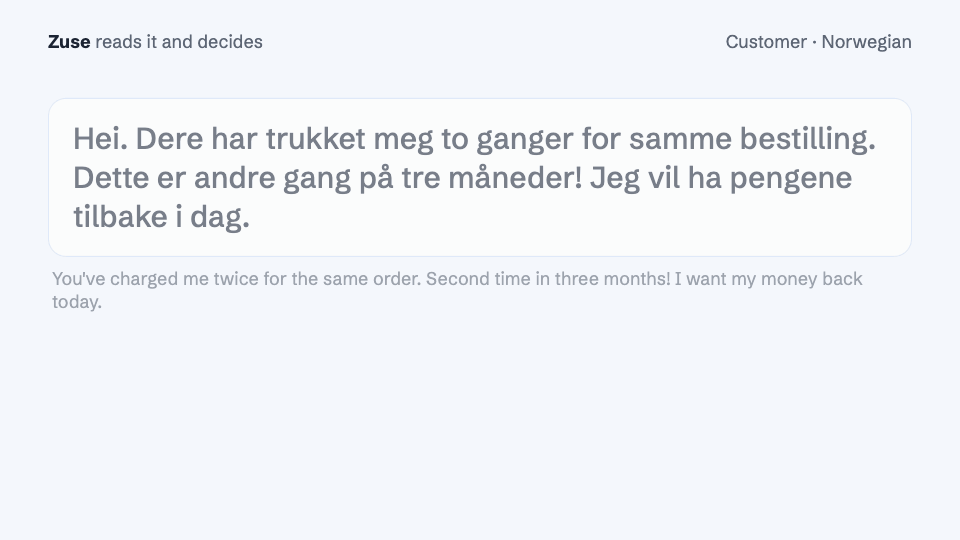

# Zuse examples

Runnable examples for **Zuse**, Bineric's decision model. Zuse reads a text and answers
fixed-choice questions about it: pick one of these options, yes or no, or a point on a scale.
Every answer comes with a probability for each option. It writes no text, so its answer is
always one of your options and there is nothing to parse. It works in 27 European languages
(and many more) and runs in the EU.



| Example | What it shows |
|---|---|
| [customer-service](customer-service/) | Five support decisions, one short file each: route tickets, hand a chatbot conversation to a person, check agent replies, decide refunds against a policy, and sort survey comments by topic. Where it matters, the cases Zuse isn't sure about go to a person. With a page for your browser and a benchmark on 900 real bank calls, compared with Claude. |
| [complaints](complaints/) | Sort real US consumer complaints by product, check every answer against the dataset's labels, and compare accuracy and cost with Claude Sonnet 5.5. |

## Setup

**1. Get an API key.** Sign up at [bineric.com/platform](https://bineric.com/platform), open
**API keys** in the dashboard and click **Generate Key**.

**2. Get the code and run an example.**

```bash
git clone https://github.com/binericai/zuse-examples.git
cd zuse-examples
pip install -r requirements.txt
cd customer-service && python app.py
```

The first time, it asks you to paste your key and saves it in `.env` in the repo folder. Or
set it up yourself: `cp .env.example .env` and put the key after `BINERIC_API_KEY=`. `.env` is
listed in `.gitignore`, so your key is never committed.

## The API in one call

```bash
curl https://api.bineric.com/v1/zuse \
  -H "Authorization: Bearer $BINERIC_API_KEY" \
  -H "Content-Type: application/json" \
  -d '{
    "model": "zuse-27b",
    "state": "Hei, dere har trukket meg to ganger for samme bestilling. Jeg vil ha pengene tilbake!",
    "questions": {
      "team":  {"type": "choice", "instructions": "Which team should handle it?",
                "criteria": {"billing": "Payments and refunds", "delivery": "Shipping", "other": null}},
      "angry": {"type": "noul",   "instructions": "Is the customer angry?"}
    }
  }'
```

The answer for `team` has a `choice`, a probability for every option, and a `confidence`;
`angry` comes back as the probability of yes. `confidence` is the top probability rescaled so
that 0 means "can't tell the options apart" and 1 means certain. The examples use the plain
probability of the chosen option, because it reads as "how likely this answer is right".
Several questions about the same text cost the text's tokens once.

Docs: [bineric.com/platform/docs#zuse](https://bineric.com/platform/docs#zuse) ·
Model page: [bineric.com/zuse](https://bineric.com/zuse)

## Two sizes

| Model | Price per million input tokens | Best for |
|---|---|---|
| `zuse-9b` | **$0.12** | High-volume sorting and routing: as accurate as 27B on the bank-call benchmark below, at a sixth of the price |
| `zuse-27b` | $0.75 | Harder judgement calls, like checking a request against a refund policy or reviewing an agent's reply |

Neither has output tokens. The examples use `zuse-27b`; put `ZUSE_MODEL=zuse-9b` in `.env` to switch.

## How it compares

Both examples include a comparison you can run yourself with Claude Sonnet 5.5, on the same
texts (thinking off, structured output, asked to say how sure it is; Anthropic list prices).
Results from 15 Nov 2026:

| | Bank calls (MINDS-14, 900): right | cost per million calls | Complaints (CFPB, 270): right | cost per million |
|---|---|---|---|---|
| Zuse 9B (`zuse-9b`) | 93.0% | **$16** | 75.2% | **$49** |
| Zuse 27B (`zuse-27b`) | 92.8% | $98 | 78.5% | $304 |
| Claude Sonnet 5.5 | 95.6% | $1,322 | 80.4% | $2,046 |

Sonnet is a few points more accurate; Zuse 9B costs about 1% of it on the bank calls. Details,
and how often each model was right when it said it was sure, are in each example's README,
and the full output of our runs is in each example's `results/` folder.

## When Zuse fits, and when it doesn't

Zuse fits decisions with a fixed set of answers that you make many times: routing, tagging,
checking against a rubric or a policy, flagging risks. You get a probability for every option,
so you can set how sure it must be before it acts, send the rest to a person, or rank options.

Use something else when you need:

- **Text written back**: a reply, a summary, an explanation. Zuse writes nothing.
- **Facts pulled out of a text**: names, amounts, dates. Use an extraction model or a language model.
- **Arithmetic or hard rules**: dates, totals, limits. Check them in code, as `refunds.py` does.
- **The highest accuracy on a hard task**: in the comparison above, Claude Sonnet 5.5 is a few
  points more accurate, at a much higher price.

## License

MIT for the code. Third-party datasets keep their own licences, named in each example.
