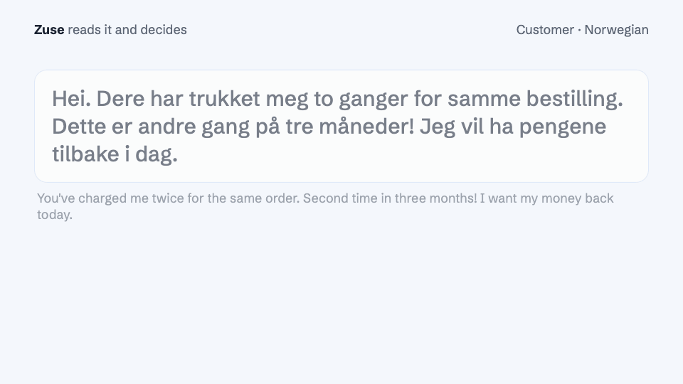

# Customer service

Five decisions a support team makes every day, each in one short Python file. Zuse answers
the questions, your code applies the rules, and when Zuse isn't sure enough the case goes to
a person.



| File | The decision |
|---|---|
| [`route_tickets.py`](route_tickets.py) | Which team gets this ticket? Data requests and legal threats get their own route. |
| [`bot_handover.py`](bot_handover.py) | After each customer message: should a person take over from the chatbot? |
| [`check_replies.py`](check_replies.py) | Is the agent's reply good, worth coaching, or must it be stopped before it's sent? |
| [`refunds.py`](refunds.py) | Does the request meet the refund policy? Deadlines and price limits are checked in code. |
| [`survey_comments.py`](survey_comments.py) | Which topics is a survey comment about? |

## Run it

From the repo root, after the [setup](../README.md#setup):

```bash
cd customer-service
python app.py                 # the page in your browser, with "Play the demo"
python route_tickets.py       # or any example in the terminal, on its sample cases
python route_tickets.py "Hei, dere har trukket meg to ganger for samme bestilling!"
```

The page shows, for each case: what Zuse reads, the questions it is asked with its answers,
and the decision your rules make. "Show the API call" shows the exact request and response.
Your API key stays in the local server (`app.py`) and never reaches the browser.

## How each example works

Every file has the same three parts:

```python
QUESTIONS = {...}         # 1. what Zuse is asked: sent as-is to POST /v1/zuse
SURE = 0.90               # 2. your rules: act on its own at this probability or above
def decide(answers): ...  #    turn Zuse's answers into a decision, or "person"
def handle(item): ...     # 3. one request, then decide
```

Zuse returns a probability for every option of every question. `chance()` in `zuse.py`
reads the probability of the option Zuse chose; that is the number the rules compare with
`SURE`. (The API's `confidence` field is the same number rescaled so 0 means "can't tell the
options apart"; see the [docs](https://bineric.com/platform/docs#zuse).)

To make one yours, change the questions to your teams, policy or topics, and keep a "none of
these" option so Zuse has somewhere to put what fits nowhere. Questions can be in any
language, and so can the messages. Then put your own labelled cases in `samples/` and run the
file to see how your rules do before you trust them.

## Results

### A public benchmark: MINDS-14

[`benchmark_minds14.py`](benchmark_minds14.py) routes 900 real calls to an e-banking line
(PolyAI's MINDS-14, 9 languages, 14 intents) and compares Zuse with Claude Sonnet 5.5. We keep
MINDS-14 out of Zuse's training data and use it only for testing. Run on 15 Nov 2026:

| | Right | Cost per 1,000 calls | Cost per million calls | Median time |
|---|---|---|---|---|
| Zuse 9B (`zuse-9b`) | 93.0% | $0.016 | **$16** | 0.9 s |
| Zuse 27B (`zuse-27b`) | 92.8% | $0.098 | $98 | 0.9 s |
| Claude Sonnet 5.5 | 95.6% | $1.32 ($0.66 batch) | $1,322 | 0.5 s |

Claude ran with thinking off and structured output, at Anthropic's list prices. Times are with
8 requests at once. The full output is in [`results/`](results/).

Zuse gives a probability for every answer, so you can let it act only when it is sure and send
the rest to a person. How often Zuse 27B was right, by how sure it said it was:

| Zuse said | Calls | Right |
|---|---|---|
| under 50% | 46 | 24% |
| 50–70% | 54 | 70% |
| 70–90% | 117 | 92% |
| 90–97% | 194 | 99% |
| 97–99% | 176 | 99% |
| 99% and above | 313 | 99% |

Acting only at 90% or above, Zuse 27B handled 76% of the calls on its own, 99.3% of them right;
Zuse 9B handled 81%, 98.9% right.

Run it yourself with `python benchmark_minds14.py` (Zuse only; add `ZUSE_MODEL=zuse-9b` in
front for the 9B), or add `--claude` (needs `ANTHROPIC_API_KEY`) or `--bedrock` (Claude through
Amazon Bedrock) for the comparison. The comparison needs `pip install -r ../requirements-benchmarks.txt`.

### The sample cases

The samples are for a made-up online shop, written by us to include hard cases: sarcasm,
polite-but-furious, a bot going in circles, a reply that leaks another customer's data, a
refund story that contradicts the order. Each has one expected answer. They show how the rules
behave; they are too few to be a benchmark. `zuse-27b`, 15 Nov 2026:

| Example | Cases | Right | Wrong | Left to a person (Zuse not sure) |
|---|---|---|---|---|
| Route tickets | 42, in 14 languages | 32 | 0 | 10 |
| Bot handover | 9 chats | 9 | 0 | 0 |
| Check replies | 12 | 11 | 0 | 1 |
| Refunds | 12 | 10 | 0 | 2 |
| Survey comments | 20 | 19 | 1 | 0 |

That is `zuse-27b`. With `zuse-9b` the same cases came out 77 right, 11 wrong and 9 left to a
person: fine for routing, weaker on the refund policy (4 wrong of 12). Use 27B for the judgement
calls.

Eight of the routing tickets are about two teams at once (a failed card payment at checkout,
for example), and either team counts as right. One survey comment ("got the wrong item") was
filed under product instead of delivery. Zuse's probabilities move a little from run to run, so a
case near a threshold can land on either side of it.

Each case is one request of 150 to 350 input tokens: about **$0.02 to $0.04 per 1,000 decisions
with `zuse-9b`**, or $0.13 to $0.18 with `zuse-27b`. Bot handover makes one request per customer
message.

## Files

| | |
|---|---|
| `zuse.py` | the API client, `chance()`, and `try_samples()` that runs a file on its samples |
| `route_tickets.py` ... `survey_comments.py` | the five examples |
| `samples/` | the sample cases, with expected answers |
| `app.py`, `web/index.html` | the local page |
| `benchmark_minds14.py`, `results/` | the MINDS-14 benchmark, and the output of our runs |

## Data licence

MINDS-14: PolyAI, [CC BY 4.0](https://creativecommons.org/licenses/by/4.0/). Gerz et al.,
*Multilingual and Cross-Lingual Intent Detection from Spoken Data*, 2021. The benchmark
downloads the transcriptions from Hugging Face; nothing from the dataset is stored in this
repository. The samples are written by Bineric and released with the code under MIT.
